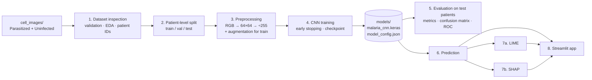

# Project Workflow: from raw images to an explained prediction




---

## Stage 1: Dataset inspection (`src/dataset_inspection.py`)
**Input:** `cell_images/Parasitized`, `cell_images/Uninfected`
1. Check that both class folders exist (otherwise stop with a clear error).
2. Open **every** file:
   * non-image files (e.g. `Thumbs.db`) are listed and skipped;
   * `Image.verify()` followed by a full decode detects corrupted files;
   * record width, height, colour mode, format, mean R/G/B and an MD5 hash.
3. Duplicates: files with identical MD5 hashes, including any duplicates that carry conflicting labels.
4. Patient ID: official NIH CSV files if they are in `metadata/`, otherwise the NIH filename
   convention (`C33P1thinF_...` → `P1`).
5. Class balance: ratio of the smaller class to the larger one (below 0.8 is flagged as imbalanced).
6. Loading validation: sample images go through the real `preprocess_image` function; the code
   asserts shape (64, 64, 3), dtype float32, range [0, 1] and the correct label.

**Output:** `outputs/reports/dataset_inventory.csv`, `dataset_report.json`, and the graphs
`class_distribution`, `sample_images`, `image_dimensions`, `colour_intensity` and `cells_per_patient`.

## Stage 2: Data split (`src/preprocessing.py → create_splits`)
* Group = patient. Groups that share a duplicate image are merged into one group.
* `StratifiedGroupKFold` (seed 42): one fold of 7 becomes **test** (about 14%), then one fold of 6
  of the rest becomes **validation** (about 14%), and the remaining ~72% is **training**.
  Stratified means each split keeps a similar Parasitized/Uninfected ratio.
* The code asserts that no patient, group or duplicate appears in two splits.

**Output:** `outputs/reports/data_split.csv`, `outputs/graphs/split_distribution.png`.

## Stage 3: Preprocessing (`src/preprocessing.py`)
The same function, `preprocess_image`, is used in training, evaluation, the app, LIME and SHAP:
```
image file ──► RGB (removes alpha/grayscale differences) ──► resize 64×64 (bilinear)
           ──► uint8 0..255 ──► ÷255 ──► float32 0..1, shape (64, 64, 3)
```
* Resized images are cached in `cache/images_64.npz` so later runs start quickly.
* **Augmentation (training only):** random horizontal and vertical flips, random 90° rotations and
  a ±5% brightness change. Cells have no natural orientation, so the label never changes.
  Validation and test images are **never** augmented.
* The settings are saved in `models/model_config.json`: class names, label mapping
  (Uninfected=0, Parasitized=1), image size, normalisation and threshold.

## Stage 4: CNN training (`src/model.py`, `src/train.py`)
```
Input 64×64×3
 ├ Block1: [Conv3×3(32) → BatchNorm → ReLU] ×2 → MaxPool 2×2 → Dropout 0.2   → 32×32×32
 ├ Block2: [Conv3×3(64) → BatchNorm → ReLU] ×2 → MaxPool 2×2 → Dropout 0.2   → 16×16×64
 ├ Block3: [Conv3×3(128)→ BatchNorm → ReLU] ×2 → MaxPool 2×2 → Dropout 0.2   →  8×8×128
 ├ GlobalAveragePooling                                                        → 128
 ├ Dense(128, ReLU, L2) → Dropout 0.5
 └ Dense(1, sigmoid)   = P(Parasitized)
```
* Loss: binary cross-entropy. Optimiser: Adam (learning rate 0.001). Class weights are "balanced".
* Callbacks: **ModelCheckpoint** saves the best model by validation loss; **EarlyStopping**
  (patience 6) stops training and restores the best weights; **ReduceLROnPlateau** halves the
  learning rate when progress stalls; **CSVLogger** records the history.
* The test set is not touched during training.

**Output:** `models/malaria_cnn.keras`, `model_config.json`, `shap_background.npy`,
`outputs/reports/training_history.csv`, `training_summary.json`, and the
`training_accuracy.png` and `training_loss.png` graphs.

## Stage 5: Evaluation (`src/evaluate.py`)
Predictions from the saved model on train, validation and test (no augmentation). The threshold is
P(Parasitized) ≥ 0.5.

| Metric | Formula | Meaning for malaria screening |
|---|---|---|
| Accuracy | (TP+TN)/all | Share of cells classified correctly |
| Precision | TP/(TP+FP) | When the model says "Parasitized", how often it is right |
| Recall / Sensitivity | TP/(TP+FN) | Share of infected cells that are caught (missing infections is dangerous) |
| Specificity | TN/(TN+FP) | Share of healthy cells correctly cleared |
| F1-score | 2·P·R/(P+R) | Balance of precision and recall |
| ROC-AUC | area under the TPR-vs-FPR curve | Ranking quality across all thresholds (0.5 = random, 1 = perfect) |
| Confusion matrix | TN, FP, FN, TP counts | Exactly which mistakes are made |

TP = parasitized predicted parasitized, TN = uninfected predicted uninfected,
FP = uninfected predicted parasitized (false alarm), FN = parasitized predicted uninfected (missed infection).

Comparing **train**, **validation** and **test** shows overfitting: a much higher training score
than test score means the model memorised rather than generalised.

**Output:** `metrics.json`, `classification_report.txt`, `test_predictions.csv`, and the graphs
`confusion_matrix`, `roc_curve`, `precision_recall_curve` and `misclassified_examples`.

## Stage 6: Prediction (`src/prediction.py`)
`MalariaPredictor` loads the model and config **once**. `predict_proba_batch(images)` returns an
(N, 2) array of `[P(Uninfected), P(Parasitized)]`. This is the function LIME and SHAP call.

## Stage 7a: LIME (`src/lime_explainer.py`)
1. SLIC splits the 64×64 image into about 40 superpixels.
2. `LimeImageExplainer` creates 1000 copies with random superpixels hidden (replaced by their mean colour).
3. The **real CNN** predicts all 1000 copies.
4. A weighted linear model (closer copies weigh more) learns how much each superpixel adds to the predicted class.
5. The figure shows the original image, the top supporting superpixels, supporting (green) versus
   opposing (red) regions, and a weight heatmap. It is saved to `outputs/explanations/lime_*.png`.

## Stage 7b: SHAP (`src/shap_explainer.py`)
* **Partition (default):** `shap.Explainer(predict_fn, shap.maskers.Image("blur(8,8)", (64,64,3)), algorithm="partition")`.
  Hidden regions are replaced by a blurred copy of the image. A hierarchical partition tree gives
  Shapley values with about 500 model calls. The values are summed over the colour channels to form a 64×64 map.
* **Gradient (optional):** `shap.GradientExplainer(model, background)` with 100 training images as
  the background dataset (expected gradients).
* **Additivity check:** baseline + Σ SHAP ≈ prediction. The gap is reported in the app.
* Figures are saved to `outputs/explanations/shap_*.png`.

## Stage 8: Streamlit app (`app.py`)
Home → Image Classification (upload or random **test** image, prediction, probabilities)
→ Explainable AI (LIME and SHAP tabs with reading guides) → Model Performance (real metrics and
graphs from `outputs/`) → About (dataset, technologies, limitations). The model is cached with
`st.cache_resource`, so it is loaded once and never retrained. Errors are shown in the app, never
hidden: missing model, unreadable file, wrong format and explanation failures.

---

## Testing status

The project was built in a cloud workspace with Python 3.13, NumPy, Pandas, Pillow,
scikit-learn, scikit-image and Matplotlib. **TensorFlow, LIME, SHAP and Streamlit were not
installed there and could not be installed (no network access)**, and your full dataset was not
available.

| Component | Status |
|---|---|
| All `.py` files: syntax and import structure | ✅ compiled successfully |
| Dataset inspection (folders, counts, corrupt/non-image files, duplicates, patient IDs, EDA graphs) | ✅ run on a synthetic NIH-style test set with planted problems |
| Official NIH CSV patient-mapping parser | ✅ run on a test file in NIH's format |
| Patient-level split + leakage assertions | ✅ run (synthetic data) |
| `preprocess_image` (path, bytes, file object, PIL, array; RGBA/grayscale inputs) | ✅ run |
| Image cache, split arrays | ✅ run |
| LIME segmentation (SLIC on 64×64 input) | ✅ run |
| Evaluation metrics and plots (`compute_metrics`, confusion matrix, ROC, PR, history curves) | ✅ run with synthetic predictions |
| CNN build, training, saving and loading | ⏳ **not yet run** (needs TensorFlow), run on your PC |
| Evaluation on the real test set | ⏳ run on your PC (`python -m src.evaluate`) |
| LIME / SHAP with the trained model | ⏳ run on your PC |
| Streamlit app | ⏳ run on your PC (`streamlit run app.py`) |
| Inspection on your real 27,558 images | ⏳ run on your PC (`python -m src.dataset_inspection`) |

No accuracy figures, predictions or explanation images in this project were invented. All results
come from running the scripts on your computer.
